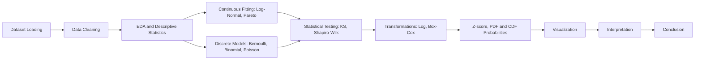

<div align="center">

<!-- Animated title (external service: readme-typing-svg.demolab.com) -->
<a href="https://github.com/">
  
</a>

### 📈 *A Statistical Distribution Analysis Model for Transaction Data* 🧮


</div>

> 🎯 **Purpose:** Analyse 220 transaction records with statistical distributions to understand how transaction amounts and counts are spread, and to estimate the probability of large transactions.

---

<a id="toc"></a>
## 📑 Table of Contents

1. [Project Overview](#overview)
2. [Project Objectives](#objectives)
3. [Dataset Description](#dataset)
4. [Technology Stack](#stack)
5. [Project Workflow](#workflow)
6. [Statistical Analysis](#analysis)
7. [Key Results Dashboard](#dashboard)
8. [Visualizations Gallery](#gallery)
9. [Model Comparison](#comparison)
10. [Installation and Setup](#setup)
11. [How to Run the Project](#run)
12. [Key Insights](#insights)
13. [Limitations and Future Improvements](#limitations)
14. [Verification Checklist](#verification)
15. [Conclusion](#conclusion)
16. [Author and Academic Information](#author)

---

<a id="overview"></a>
## 🔭 Project Overview

**Spread Locator** studies how transaction amounts and counts are distributed. Fitting a statistical distribution is useful because it:

- 📐 summarises a dataset with a few interpretable parameters,
- 🎲 lets us estimate probabilities (for example, the chance a transaction exceeds a threshold),
- 🔍 shows whether assumptions such as normality hold, and which transformation helps,
- 🚩 helps flag unusual values for review (not automatic proof of fraud).

The transaction amounts are strongly right-skewed (a few very large values), which motivates Log-Normal, Pareto-type and Box-Cox analysis.

---

**Presention Video link** : https://drive.google.com/file/d/1lzmIT3RhpIQbMPki9nvIvVzFvbDXxTx7/view?usp=sharing

<a id="objectives"></a>
## 🎯 Project Objectives

| # | Objective | Notebook topic |
|---|-----------|----------------|
| 1 | Load, clean and explore the data (EDA, descriptive statistics) | 🧹 Cleaning / EDA |
| 2 | Binary outcome analysis with the **Bernoulli** distribution | ✅ `transaction_status` |
| 3 | Count comparison with the **Binomial** distribution | 🔢 `transaction_count` |
| 4 | Daily record counts with the **Poisson** distribution | 📅 31 days |
| 5 | Fit the **Log-Normal** distribution | 💰 `transaction_amount` |
| 6 | Fit a **Power-Law / Pareto-type** distribution | 📉 Heavy tail |
| 7 | **Q-Q plots** and **Shapiro–Wilk** normality testing | 📏 Raw vs log |
| 8 | **Box-Cox** transformation | 🔄 Skewness reduction |
| 9 | **Z-score** and threshold probability | 🧮 ₹5,000 threshold |
| 10 | **PDF and CDF** analysis | 📈 Fitted Log-Normal |
| 11 | Comparison of fitted distributions (KS, AIC) | ⚖️ Log-Normal vs Pareto |
| 12 | Optional **OLS** time-index diagnostic | 🕒 `day_index` |

---

<a id="dataset"></a>
## 🗂️ Dataset Description

**File:** `spread_locator_dataset.xlsx` · **Shape (reported):** 220 rows × 7 columns · **Date range:** 1 Jan 2023 – 31 Jan 2023

| Column | Meaning |
|--------|---------|
| `transaction_id` | Identifier of a transaction |
| `customer_id` | Identifier of a customer (217 unique reported) |
| `transaction_amount` | Monetary amount of a transaction |
| `transaction_date` | Date of a transaction |
| `transaction_count` | Count variable used for Binomial demonstration |
| `region` | Transaction region |
| `transaction_status` | Status used for the Bernoulli (success/failure) coding |

> 🔎 **Data types:** to be confirmed from `df.dtypes` in the notebook (amount and count are numeric, date is parsed with `pd.to_datetime`, others are text/identifiers).

> 💱 **Currency note:** The dataset has no explicit currency field. The notebook labels the threshold as **₹5,000**, so ₹ is used for that context. Treat other amounts as "currency units" unless confirmed.

### ✅ Data quality checks (reported)

| Check | Result |
|-------|--------|
| Missing values | 0 in all columns |
| Duplicate rows | 0 |
| Duplicate transaction IDs | 0 |
| Positive transaction amounts | 220 / 220 |
| Non-negative transaction counts | 220 / 220 |

### 📊 Descriptive statistics of `transaction_amount` (reported)

| Statistic | Value |
|-----------|------:|
| Observations | 220 |
| Total amount | 740,342.33 |
| Mean | 3,365.19 |
| Median | 3,077.72 |
| Standard deviation | 1,985.71 |
| Variance (sample) | 3,943,025.97 |
| Minimum | 804.42 |
| Q1 / Q3 | 2,124.21 / 3,950.74 |
| IQR | ≈ 1,826.53 |
| Maximum | 20,462.84 |
| Skewness | 3.7558 |
| Excess kurtosis | 25.9462 |

**Region counts:** West 66 · South 59 · East 50 · North 45.
**Status counts (under the notebook's coding rule):** Success 98 · Failure 122.

---

<a id="stack"></a>
## 🧰 Technology Stack

| Library | Role |
|---------|------|
|  | Core language |
|  | Loading Excel, cleaning, grouping |
|  | Arrays and numeric calculations |
|  | Distributions, fitting, KS and Shapiro–Wilk tests, Box-Cox |
|  | OLS regression diagnostics |
|  | Plots (histograms, Q-Q, PDF/CDF) |
| Seaborn | Statistical plot styling (used in the notebook) |
| OpenPyXL | Engine used by Pandas to read `.xlsx` (needed at runtime) |
|  | Notebook environment (developed in VS Code) |

---

<a id="workflow"></a>
## 🔄 Project Workflow



---

<a id="analysis"></a>
## 🧮 Statistical Analysis

### 1️⃣ Bernoulli Distribution

**Purpose:** Estimate the probability of a binary outcome using `transaction_status` (recognised success labels → 1, others → 0).

$$P(X=x)=p^x(1-p)^{1-x},\quad E(X)=p,\quad \operatorname{Var}(X)=p(1-p)$$

| Quantity | Value |
|----------|------:|
| Successes / Failures | 98 / 122 |
| $\hat p = 98/220$ | **0.4455 (44.55%)** |
| $1-\hat p$ | **0.5545 (55.45%)** |

**Interpretation:** These are sample proportions under the notebook's coding rule. Check the real status labels before drawing business conclusions.

### 2️⃣ Binomial Distribution

**Purpose:** Compare observed `transaction_count` frequencies with fitted Binomial frequencies.

$$P(X=k)=\binom{n}{k}p^k(1-p)^{n-k},\quad \hat p=\frac{\bar x}{n}=\frac{2.8545}{9}\approx 0.3172$$

| Count | 0 | 1 | 2 | 3 | 4 | 5 | 6 | 7 | 8 | 9 |
|------:|--:|--:|--:|--:|--:|--:|--:|--:|--:|--:|
| Observed | 15 | 40 | 48 | 47 | 27 | 25 | 12 | 3 | 2 | 1 |
| Expected | 7.10 | 29.68 | 55.14 | 59.77 | 41.64 | 19.34 | 5.99 | 1.19 | 0.14 | 0.01 |

**Interpretation:** Observed and expected frequencies differ noticeably (e.g. 15 observed vs 7.10 expected at count 0).
⚠️ **Assumption:** $n=9$ is based on the maximum observed count, not a confirmed number of trials. The observed counts sum to 220, matching the dataset size.

### 3️⃣ Poisson Distribution

**Purpose:** Model the number of transaction records per calendar day (days with zero records included).

$$P(X=k)=\frac{e^{-\lambda}\lambda^k}{k!},\qquad \hat\lambda=\frac{220}{31}=7.0968$$

| Quantity | Value |
|----------|------:|
| Days in range | 31 |
| Total records | 220 |
| Fitted rate $\hat\lambda$ | **7.0968** |
| Daily mean / sample variance | 7.0968 / 5.2903 |
| $P(X=6)$ | ≈ 0.1469 |
| Expected days with 6 records | ≈ 4.55 (observed: 8) |

**Interpretation:** Variance (5.29) is below the mean (7.10), i.e. the counts are *less* variable than a Poisson model implies. Constant-rate and independence assumptions need checking.

### 4️⃣ Log-Normal Distribution

**Purpose:** Fit a continuous model to positive, right-skewed transaction amounts (location fixed at 0).

$$\ln(X)\sim N(\mu,\sigma^2),\qquad f(x)=\frac{1}{x\sigma\sqrt{2\pi}}\exp\!\left(-\frac{(\ln x-\mu)^2}{2\sigma^2}\right)$$

| Parameter | Value |
|-----------|------:|
| $\mu$ (log-scale mean) | 8.000738 |
| $\sigma$ (shape) | 0.474918 |
| SciPy scale $=e^{\mu}$ | ≈ 2,983.16 |
| KS statistic | 0.0378 |
| Approx. KS p-value | 0.8999 |

**Interpretation:** The small KS gap suggests a close match to the empirical CDF. The p-value is only approximate because parameters were estimated from the same sample.

### 5️⃣ Power Law / Pareto-Type Distribution

**Purpose:** Test whether a heavy-tailed Pareto-type model describes the amounts.

$$f(x)=Cx^{-\alpha},\quad x\ge x_{\min}$$

| Metric | Value |
|--------|------:|
| SciPy Pareto shape $b$ | 0.7630 |
| Equivalent density exponent $\alpha=b+1$ | ≈ 1.7630 |
| Scale ($x_{\min}$) | 804.42 |
| KS statistic | 0.3216 |
| Approx. KS p-value | $9.57\times10^{-21}$ |

**Exploratory tail fit (from earlier analysis, not in the master summary's notebook description — verify before use):** threshold 3247.64, 101 tail observations, exponent ≈ 4.1476.

**Interpretation:** The full-range Pareto fit is poor. A formal Power Law analysis needs justified tail selection; a long tail alone does not prove a Power Law.

### 6️⃣ Q-Q Plot and Normality Testing

**Purpose:** Compare raw and log-transformed amounts with a Normal reference (Q-Q plot + Shapiro–Wilk, $\alpha=0.05$).

| Data | W | p-value | Decision |
|------|--:|--------:|----------|
| Raw amounts | 0.7361 | $1.91\times10^{-18}$ | Reject normality |
| Log amounts | 0.9894 | 0.1061 | Do not reject normality |

**Interpretation:** Log amounts are consistent with a Normal distribution at the 5% level, supporting a Log-Normal model. Not rejecting normality does not prove it.

### 7️⃣ Box-Cox Transformation

**Purpose:** Reduce skewness of positive data.

$$Y(\lambda)=\begin{cases}\dfrac{Y^{\lambda}-1}{\lambda}, & \lambda\ne0\\[6pt] \ln Y, & \lambda=0\end{cases}$$

| Metric | Value |
|--------|------:|
| Estimated $\lambda$ | −0.1808 |
| Skewness before | 3.7558 (current rerun) |
| Skewness after | −0.0107 |

> ⚠️ **Discrepancy:** An earlier report gave the original skewness as ≈ 3.73. The current rerun gives 3.7558. The final value must be taken from the executed notebook. Note that $\lambda$ is *near* zero (close to a log transform) but is **not exactly zero**.

**Interpretation:** Skewness drops sharply. This does not by itself prove the transformed data is Normal.

### 8️⃣ Z-Score Analysis

**Purpose:** Locate the ₹5,000 threshold relative to the sample mean and estimate exceedance probability.

$$z=\frac{x-\bar x}{s}=\frac{5000-3365.19}{1985.71}\approx 0.8233$$

| Quantity | Value |
|----------|------:|
| Transactions above ₹5,000 | 25 of 220 |
| Empirical $P(X>5000)$ | **0.1136 (11.36%)** |
| Log-Normal $P(X>5000)$ | **0.1384 (13.84%)** |
| Min / Max z-score | −1.2896 / 8.6104 |
| Observations with $\lvert z\rvert>3$ | 3 |

**Interpretation:** Sample and model estimates differ (11.36% vs 13.84%). High z-scores flag unusual values for review, not fraud.

### 9️⃣ PDF and CDF Analysis

$$F(x)=P(X\le x),\qquad P(X>x)=1-F(x)$$

| Threshold | Model $P(X\le x)$ | Model $P(X>x)$ | Observed $P(X\le x)$ |
|----------:|------------------:|---------------:|---------------------:|
| 2,000 | 0.1999 | 0.8001 | 0.2182 |
| 3,000 | 0.5047 | 0.4953 | 0.4864 |
| **5,000** | **0.8616** | **0.1384** | **0.8864** |
| 10,000 | 0.9946 | 0.0054 | 0.9864 |

**Interpretation:** The fitted Log-Normal CDF tracks the empirical CDF closely but not exactly.

### ➕ Optional: OLS Time-Index Diagnostic

$$\widehat{Y}=3150.9553+14.5559\,X$$

| Metric | Value |
|--------|------:|
| $R^2$ / Adj. $R^2$ | 0.005 / 0.000 |
| Slope p-value | 0.310 (not significant) |
| 95% CI for slope | −13.659 to 42.771 |
| Durbin–Watson | 1.994 |
| Residual skewness / kurtosis | 3.719 / 28.365 |

**Interpretation:** No significant linear trend over the month; residuals are strongly non-normal. Use as a descriptive diagnostic only.

---

<a id="dashboard"></a>
## 📊 Key Results Dashboard

<table align="center">
<tr>
<td align="center"><b>🧾 Records</b><br><h3>220</h3></td>
<td align="center"><b>💰 Mean</b><br><h3>3,365.19</h3></td>
<td align="center"><b>📍 Median</b><br><h3>3,077.72</h3></td>
<td align="center"><b>↔️ Std. Dev.</b><br><h3>1,985.71</h3></td>
</tr>
<tr>
<td align="center"><b>✅ Success</b><br><h3>44.55%</h3></td>
<td align="center"><b>❌ Failure</b><br><h3>55.45%</h3></td>
<td align="center"><b>📅 Poisson λ</b><br><h3>7.0968</h3></td>
<td align="center"><b>🔄 Box-Cox λ</b><br><h3>−0.1808</h3></td>
</tr>
</table>

| Metric | Value |
|--------|------:|
| Log-Normal $\mu$, $\sigma$ | 8.000738, 0.474918 |
| Pareto density exponent (full range) | ≈ 1.7630 |
| Shapiro–Wilk (raw) | W = 0.7361, p = $1.91\times10^{-18}$ |
| Shapiro–Wilk (log) | W = 0.9894, p = 0.1061 |
| Observed $P(X>5000)$ | 11.36% |
| Log-Normal $P(X>5000)$ | 13.84% |
| Observed $P(X\le5000)$ | 88.64% |
| Log-Normal $P(X\le5000)$ | 86.16% |

> 💱 The ₹5,000 threshold is as labelled in the notebook; the dataset itself does not state a currency.

---

<a id="gallery"></a>
## 🖼️ Visualizations Gallery

| Suggested file | Chart |
|----------------|-------|
| `Visuals/Binomial Distribution.png` | Transaction amount histogram |
| `Visuals/Log-Normal Distribution.png` | Histogram with fitted Log-Normal PDF |
| `Visuals/Power Law Fit.png` | Pareto / Power Law fit |
| `Visuals/Poisson Distribution.png` | Daily counts vs Poisson |
| `Visuals/Q-Q Plot.png` | Q-Q plots (raw and log) |
| `Visuals/Pdf-Cdf_plot.png` | PDF and CDF curves |
| `Visuals/Binomial Distribution.png` | Observed vs expected comparison |

**How to export:** after each plotting code line in the notebook add

```python
import os
os.makedirs("Visuals", exist_ok=True)
plt.savefig("Visuals/Binomial Distribution.pn", dpi=200, bbox_inches="tight")
```

before `plt.show()`, then re-run the cell.

---

<a id="comparison"></a>
## ⚖️ Model Comparison

| Model | Purpose | Log-likelihood | AIC | KS stat. | Main limitation |
|-------|---------|---------------:|----:|---------:|-----------------|
| Bernoulli | Success/failure | n/a | n/a | n/a | Depends on status coding |
| Binomial | Count frequencies | n/a | n/a | n/a | $n=9$ is assumed |
| Poisson | Daily counts | n/a | n/a | n/a | Counts are under-dispersed |
| **Log-Normal** | Amounts | −1908.5139 | **3821.0278** | **0.0378** | KS p-value approximate; positive values only |
| Pareto | Heavy tail | −2039.6719 | 4081.3438 | 0.3216 | Full-range fit is poor; tail not justified |

$$\Delta AIC = 4081.3438-3821.0278 = 260.3160$$

✅ **Among the two fitted continuous models, Log-Normal is the stronger candidate** (lower AIC and KS). Both were fitted to the same positive amounts, so the AIC comparison is like-for-like.

---

<a id="setup"></a>
## ⚙️ Installation and Setup

```bash
# 1. Clone (replace with your repository URL)
git clone https://github.com/<your-username>/<your-repo>.git
cd <your-repo>

# 2. Create and activate a virtual environment
python -m venv .venv
source .venv/bin/activate        # Windows: .venv\Scripts\activate

# 3. Install dependencies
pip install numpy pandas scipy statsmodels matplotlib seaborn openpyxl jupyter
```

> 📝 A `requirements.txt` is **not yet in the repository**. Create one with `pip freeze > requirements.txt` after installing, if you want reproducible versions.

---

<a id="run"></a>
## ▶️ How to Run the Project

1. Keep both files in the same folder: `spread_locator_dataset.xlsx` and `spread_locator_analysis.ipynb`.
2. Open the notebook in VS Code (Jupyter extension) or run `jupyter notebook`.
3. Check that `DATA_PATH` in the data-loading cell points to `spread_locator_dataset.xlsx`.
4. Choose **Run All** (top to bottom) and compare outputs with this README.
5. Save the executed notebook with its outputs.

> Filename case matters on GitHub/Linux: the notebook is referred to as `spread_locator_analysis.ipynb`. Make sure links match the real file name.

---

<a id="insights"></a>
## 💡 Key Insights

- 📈 Transaction amounts are strongly right-skewed (mean 3,365 > median 3,078; max 20,463).
- 🧪 Raw amounts fail normality; their logarithms do not.
- 🏆 Log-Normal fits better than a full-range Pareto model.
- 🔄 Box-Cox cuts skewness from ≈ 3.76 to ≈ −0.01.
- 🎯 About 11.4% of transactions exceed ₹5,000 (observed); the model says 13.8%.
- 🕒 No significant linear time trend in January 2023.

---

<a id="limitations"></a>
## 🚧 Limitations and Future Improvements

**Completed work (reported):** EDA, Bernoulli, Binomial, Poisson, Log-Normal and Pareto fits, KS/AIC comparison, Shapiro–Wilk, Q-Q plots, Box-Cox, Z-scores, PDF/CDF, OLS diagnostic.

**Limitations**
- Only 31 days and 220 records.
- Binomial trial count $n=9$ is an assumption.
- Poisson uses daily row counts as an event proxy and shows under-dispersion.
- KS p-values are approximate (parameters estimated from the data).
- Full-range Pareto fit is not a proper Power Law analysis.

**Proposed future work (not yet done)**
- 🔬 Formal tail selection and goodness-of-fit tests (e.g. likelihood-ratio tests vs alternatives).
- 📆 Longer transaction history.
- ⚖️ More candidate models (Gamma, Weibull, etc.).
- 🎨 Exported, polished visualizations.

---

<a id="verification"></a>
## ✅ Verification Checklist

- [ ] Re-run the notebook top to bottom and compare every value above
- [ ] Confirm data types, row/column counts, and the 217 unique customers
- [ ] Confirm rows used and $n=9$ in the Binomial cell
- [ ] Resolve the Box-Cox original-skewness discrepancy (3.73 vs 3.7558)
- [ ] Confirm the exploratory tail-fit values (3247.64, 101 obs, 4.1476) exist in the notebook, or remove them
- [ ] Export charts and add them to the gallery
- [ ] Confirm status label mapping and currency

---

<a id="conclusion"></a>
## 🏁 Conclusion

Transaction amounts in this dataset are right-skewed and are described well by a **Log-Normal** distribution, supported by the log-scale Shapiro–Wilk result, a small KS statistic and a lower AIC than the Pareto alternative. Count and Poisson models are useful demonstrations but rest on assumptions. Further validation is recommended before drawing firm conclusions.

---

<a id="author"></a>

| Field | Details |
|-------|---------|
| Author | `[Tej Patel]` |
| Project | `[Spread Locator: A Statistical Distribution Analysis Model]` |
| Submission date | `[12-Oct-2026]` |

<div align="center">

⭐ Presention Video link : https://drive.google.com/file/d/1lzmIT3RhpIQbMPki9nvIvVzFvbDXxTx7/view?usp=sharing

</div>
